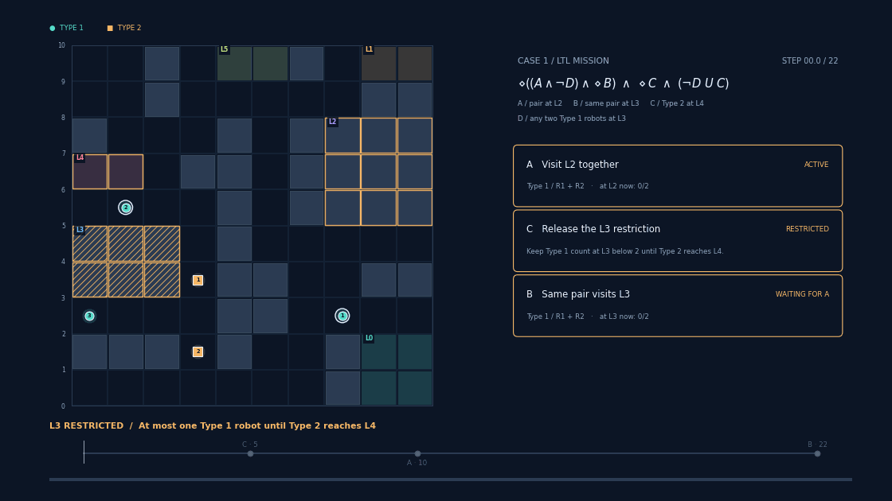
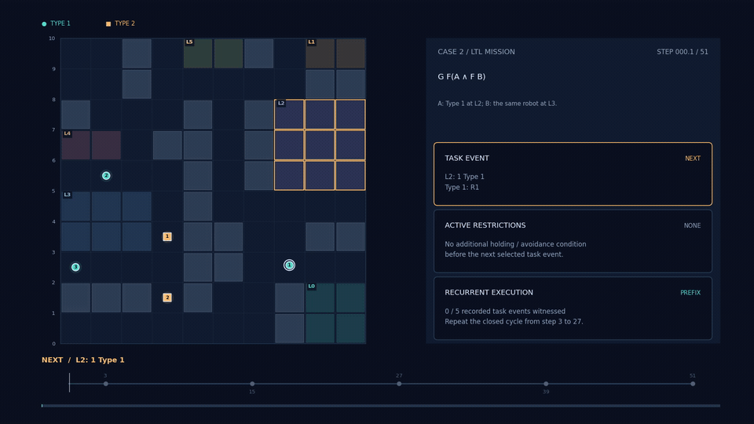
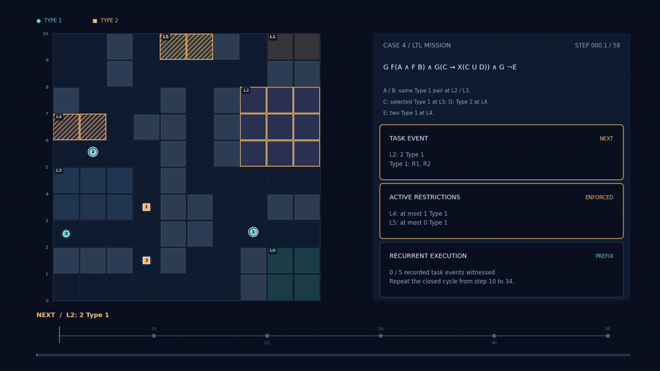
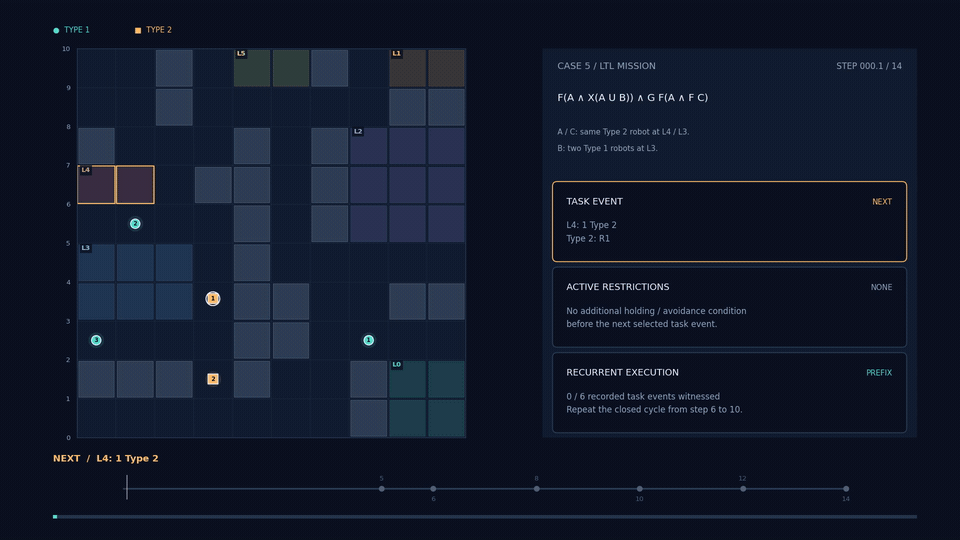
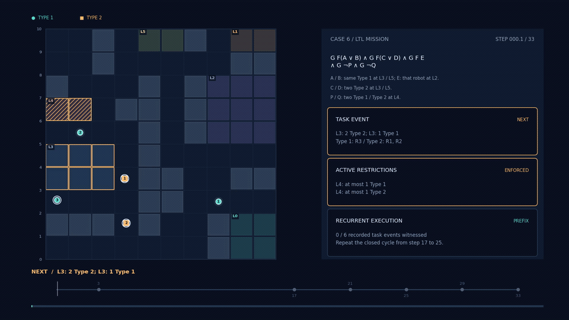
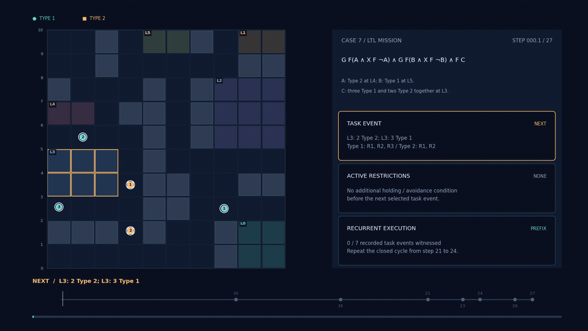
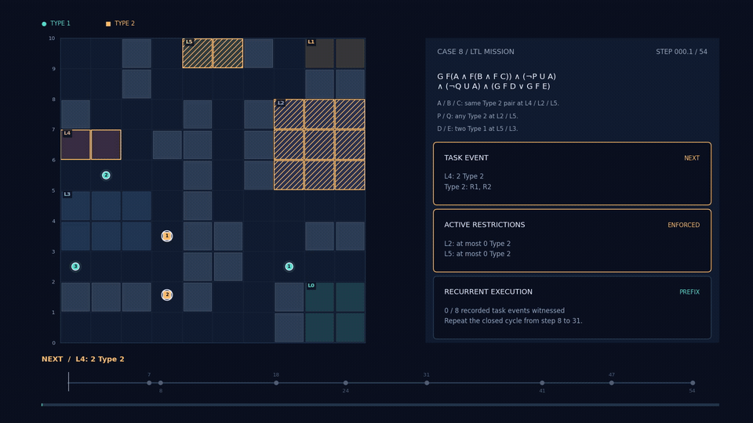
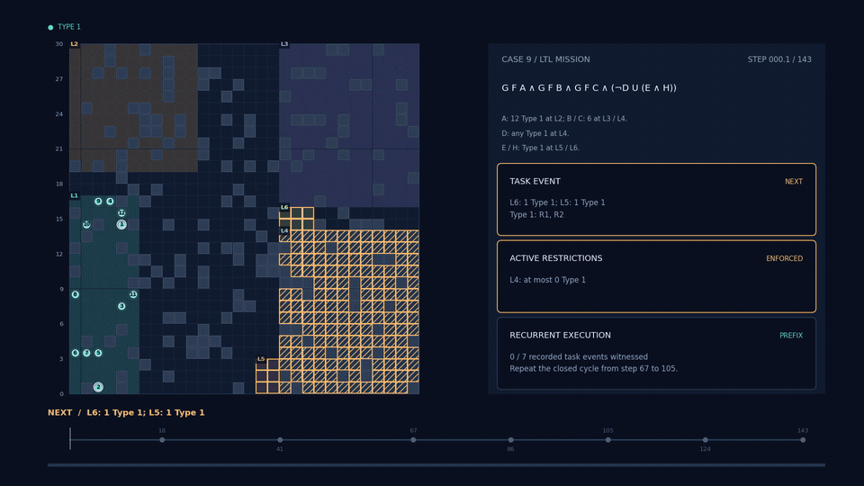
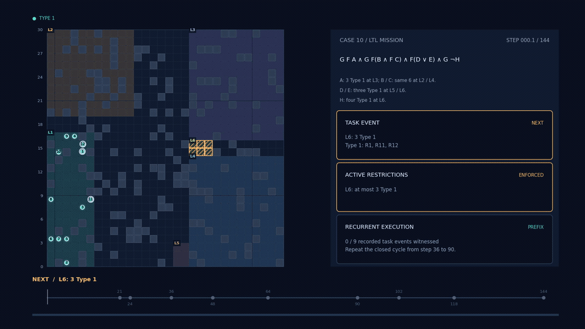

# Multi-robot Task Allocation and Planning under Linear Temporal Logic Specifications

**[Project website & interactive demo gallery](https://xushengluo92.github.io/LTL_MRTA/)**

We consider the problem of optimally allocating tasks, expressed as global Linear Temporal Logic (LTL) specifications, to teams of heterogeneous mobile robots. The robots are classified in different types that capture their dif- ferent capabilities, and each task may require robots of multiple types. The specific robots assigned to each task are immaterial, as long as they are of the desired type. Given a discrete workspace, our goal is to design paths, i.e., sequences of discrete states, for the robots so that the LTL specification is satisfied. To obtain a scalable solution to this complex temporal logic task allocation problem, we propose a hierarchical approach that first allocates specific robots to tasks using the information about the tasks contained in the Nondeterministic Bu ̈chi Automaton (NBA) that captures the LTL specification, and then designs low- level executable plans for the robots that respect the high-level assignment. Specifically, we first prune and relax the NBA by removing all negative atomic propositions. This step is motivated by “lazy collision checking” methods in robotics and allows to simplify the planning problem by checking constraint satisfaction only when needed. Then, we extract sequences of subtasks from the relaxed NBA along with their temporal orders, and formulate a Mixed Integer Linear Program (MILP) to allocate these subtasks to the robots. Finally, we define generalized multi-robot path planning problems to obtain low-level executable robot plans that satisfy both the high-level task allocation and the temporal constraints captured by the negative atomic propositions in the original NBA. We show that our method is complete for a subclass of LTL that covers a broad range of tasks and present numerical simulations demonstrating that it can generate paths with lower cost, considerably faster than existing methods.

# Presentation demo

All **ten planner-generated demos** below show LTL task progress alongside robot
movement. Cases 1–8 use three Type 1 and two Type 2 robots; Cases 9–10 use 12
Type 1 robots. Click any animated preview to open its full 1080p MP4.

| Simulation | Videos |
| --- | --- |
| I | [Case 1](#case-1--release-a-restriction-before-a-paired-visit) · [Case 2](#case-2--repeated-visits-by-the-same-robot) |
| II | [Case 3](#case-3--a-recurring-four-region-tour) · [Case 4](#case-4--conditional-holding-and-permanent-avoidance) · [Case 5](#case-5--hold-a-robot-until-another-team-arrives) · [Case 6](#case-6--alternative-destinations-with-occupancy-limits) · [Case 7](#case-7--repeated-arrival-and-departure-plus-a-rendezvous) · [Case 8](#case-8--unlock-two-regions-before-a-recurring-tour) |
| III | [Case 9](#case-9--12-robot-recurring-visits) · [Case 10](#case-10--12-robot-identity-and-safety-constraints) |

The `--vis` renderer now produces widescreen videos with smooth robot motion,
color- and shape-coded robot types, recent path trails, labeled task regions,
a step counter, and current region occupancy. Planner paths and allocation logic
are unchanged. No LaTeX installation is needed for the renderer.

Try the included **Case 1 mission replay** without Gurobi or `ltl2ba`:

```bash
cd /path/to/LTL_MRTA
python -m pip install -r requirements-demo.txt
python -m mrta.demo
```

The default sample uses the Simulation I workspace and illustrative, collision-free
paths that satisfy the Case 1 position-based monitor. These paths are not an
optimizer result. The original visual-only sample is still available with
`--replay demo/sample.json`.

The Case 1 mission panel shows the exact obligation
`F((A & !D) & F B) & F C & (!D U C)`:

- **A:** the selected Type 1 pair visits L2 together, while fewer than two Type 1
  robots occupy L3. The visit remains witnessed after they leave L2.
- **C:** any Type 2 robot reaches L4. L3's amber hatching disappears and the
  restriction stays released, including after the Type 2 robot leaves L4.
- **B:** the same Type 1 pair subsequently visits L3 together.
- **D:** any two Type 1 robots are in L3, including robots outside the selected
  pair. One Type 1 robot is allowed before release. Arrival of the second on the
  same integer step as C is also allowed by `until`.

White rings identify the tracked pair. Cards distinguish remembered visits from
current occupancy. An early violation remains red even if Type 2 later reaches
L4. Task cards remain pending when required visits have not yet occurred.
Events are computed from integer path positions, never animation frames or
scheduled timestamps. Seeking backward restores the corresponding logical state.

In the included replay, A is witnessed at step **1**, C releases the restriction
at **10**, Type 2 leaves L4 at **13**, and B completes the mission at **20**.
Click the event timeline to seek, or press **N/P** for the next/previous event.
The timeline includes dimmed future events from the recorded replay; cards and
verdicts use only the history through the current step.

Interactive playback needs a desktop Matplotlib backend (for example TkAgg or
QtAgg). Press **Space** to pause/resume, **Left/Right** to step, and **R** to restart.
For servers or presentation slides, export directly without a display:

```bash
# 1920 × 1080, 30 fps H.264 video
python -m mrta.demo --output data/demo.mp4
# A still at a chosen plan step
python -m mrta.demo --output data/poster.png --step 10
# A compact animation; lower resolution keeps GIF memory use manageable
python -m mrta.demo --output data/demo.gif --fps 15 --dpi 60
```

`--speed` sets plan steps per second (default 2); `--fps` controls motion
smoothness, and `--dpi` controls export size. MP4 uses system FFmpeg or the
`imageio-ffmpeg` binary included with the demo dependencies. GIF needs no encoder.

Existing planner `--vis` calls automatically use the new renderer and keep their
MP4 filenames. They also save a `.png` poster and a portable `.json` replay next
to the movie, even if the video encoder is unavailable. You can reopen or export
that result later without loading the optimizer:

```bash
python -m mrta.demo --replay data/mapp_case1.json
python -m mrta.demo --replay data/mapp_case1.json --output data/case1-talk.mp4
```

Case 1 planner calls also export the pair from `id2robots[1]` and the task formula
in the JSON `mission` field. Thus the mission panel tracks the optimizer's actual
assignment on the final paths. Older Case 1 replays can be opened with
`--replay path/to/replay.json --case 1`; without an assignment, the monitor tracks
all eligible Type 1 pairs rather than committing to the first one it sees.
The optional metadata format is:

```json
"mission": {"case": 1, "team": [[1, 0], [1, 1]]}
```

Robot IDs in JSON are `[type, zero_based_index]`. `formula` is an optional field;
if supplied, it must match the supported Case 1 specification. Cases 2–10 show the selected accepting run: the next assigned task, active
holding/avoidance constraints, and prefix/cycle progress. Task events are checked
against the actual robot positions at the retimed transition step. Their replays
include the formula, prefix and suffix bindings, loop boundaries, and transitions.
A separate checker evaluates the repository's future-time LTL syntax on the
infinite repetition of the closed suffix, including `X`, strong `U`, and robot
identity bindings. It also checks grid moves, obstacles, vertex collisions, and
edge swaps. Unassigned identity IDs from vacuous implications are searched as
explicit validation witnesses and identified as inferred in the validation file;
they are not reported as optimizer assignments.

Robot numbers are local to each type; color and marker shape identify the type.
Labels are hidden above 24 robots to reduce clutter. Playback interpolates
each original grid edge linearly and holds completed paths in place. Closed
prefix/suffix paths repeat one additional suffix cycle.

### Generate the complete demo collection

```bash
conda activate ltl_mrta
cd /path/to/LTL_MRTA
python scripts/run_demo_batch.py --cases 2 3 4 5 6 7 8 9 10 --output-dir data/all_cases
python scripts/render_demo_batch.py --output-dir data/all_cases --workers 3
```

The batch uses the actual collision-avoiding planners with seed 42, and 12
robots for the larger Cases 9–10. This gives six-robot `n/2` visits and
three-robot `n/4` visits. Override with `--robots`
when planning. Each case has a 1080p MP4, GIF preview, PNG still, portable JSON
replay, solver log, and validation report. Rendered replays include a prefix and
two executions of the suffix. Recurrence is checked against the repeating suffix,
not inferred from a finite playback completing.

Use `--cases` to regenerate selected cases. The Case 1 video is included in the
collection; it can also be regenerated with `--cases 1` on both batch commands.
The collection's `README.txt` lists the files. `rendered.json` contains the video
frame counts, replay checksums, and validation results.

Visualization regression checks (no solver required):

```bash
python -m unittest discover -s tests -v
```

# Install
 The code is tesed using Python 3.10.12.
### Develop via Conda
 Following the instruction:
```bash
cd /path/to/LTL_MRTA
conda env create -f environment.yml
```
### Run Case 1 in Conda

```bash
conda activate ltl_mrta
cd /path/to/LTL_MRTA
PYTHONHASHSEED=0 python -m case.case1 --case=1 --partial_or_full=f --planning-mode=simultaneous --seed=42 --only_first --loop --vis --print
python -m mrta.demo --replay data/mapp_case1.json
```

If Conda is not initialized in the current terminal, first run
`source ~/miniforge3/etc/profile.d/conda.sh` (adjust to your Conda installation).
`--planning-mode=simultaneous` selects the existing collision-avoiding mode.
The default `both` mode retains the original order, which tries sequential
planning without collision avoidance first; combined with `--only_first`, it
can stop before trying collision avoidance. `--seed` makes the initial positions
reproducible. A valid full Gurobi license and the `ltl2ba` executable are required.
For a license stored outside a default location, set `GRB_LICENSE_FILE` to its
local path; never add the license file to the repository.

### Import as package
```bash
cd /path/to/LTL_MRTA
pip install -e .
```
### Install ltl2ba
Download the software `LTL2BA` from this [link](http://www.lsv.fr/~gastin/ltl2ba/index.php), and follow the instructions to generate the exectuable `ltl2ba` and then copy it into the root folder `LTL_MRTA`.
### Install solver [Gurobi](https://www.gurobi.com)
# Example

### Simulation I
$$
\begin{align}
\phi_1 &= \lozenge \left(\left(\pi_{2,1}^{2,1}\wedge \neg \pi_{2,1}^{3}\right) \wedge  \lozenge \pi_{2,1}^{3,1}\right)  \wedge \lozenge \pi_{1,2}^{4} \wedge \neg \pi_{2,1}^{3} \ U\  \pi_{1,2}^{4} \\
\phi_2 &= \square \lozenge \left(\pi_{1,1}^{2,1} \wedge \lozenge \pi_{1,1}^{3,1}\right)
\end{align}
$$

where the atomic proposition $\pi_{i, j}^k$ is true if there exist at least $i$ robots of type $j$ at region $\ell_k$ at the same time. APs with identical second superscripts should be satisfied by same robots. For instance, $\pi_{2,1}^{2,1}$ and $\pi_{2,1}^{3,1}$ require that the same set of 2 robots of type 1 visit regions $\ell_2$ and $\ell_3$, respectively.
```bash
# change c to 1, 2
python ./case/case1.py --case=c --partial_or_full=f --only_first --loop --vis --print
```
The explanation of arguments can be found in function [create_parser](mrta/util.py).

#### Case 1 — Release a restriction before a paired visit

[](demo/generated/case_01.mp4)

[Watch MP4](demo/generated/case_01.mp4) · [Replay JSON](demo/generated/case_01.json) · [Validation report](demo/generated/case_01.validation.json)

A selected pair of Type 1 robots must visit **L2 together**, then **L3
together**. At the L2 visit, fewer than two Type 1 robots may occupy L3.
Until a Type 2 robot reaches **L4**, L3 may contain at most one Type 1 robot;
that arrival releases the restriction permanently.

In this optimizer-generated run, the Type 2 robot releases the restriction at
**step 5**, the selected pair reaches L2 at **step 10**, and the same pair
reaches L3 at **step 22**. The task permits release before the L2 visit.
The cards remember completed visits, while the L3 hatching shows whether the
restriction is still active. This run differs from the illustrative default
sample described above.

#### Case 2 — Repeated visits by the same robot

[](demo/generated/case_02.mp4)

[Watch MP4](demo/generated/case_02.mp4) · [Replay JSON](demo/generated/case_02.json) · [Validation report](demo/generated/case_02.validation.json)

The same selected Type 1 robot must visit **L2 and then L3 repeatedly**.
The panel follows that robot's assigned visits through the initial prefix and
two executions of the closed cycle. A single completed L2–L3 trip is a
milestone; the repeating cycle fulfills the recurring obligation.

### Simulation II
$$
\begin{align}
   \phi_3 &= \square \lozenge (\pi_{2,1}^{2,1} \wedge \lozenge (\pi_{2,1}^{3,1} \wedge \lozenge (\pi_{2,1}^{4,1} \wedge \lozenge \pi_{2,1}{5,1}  )   )  ) \\
   \phi_4 & = \square \lozenge (\pi_{2,1}^{2,1} \wedge \lozenge \pi_{2,1}^{3,1}) \wedge \square (\pi_{1,1}^{5,2} \Rightarrow \bigcirc (\pi_{1,1}^{5,2} \ U \  \pi_{1,2}^{4})) \wedge \square \neg \pi_{2,1}^{4}\\
   \phi_5  & = \lozenge (\pi_{1,2}^{4,1} \wedge \bigcirc (\pi_{1,2}^{4,1} \ U \  \pi_{2,1}^{3})) \wedge \square \lozenge ( \pi_{1,2}^{4,1} \wedge \lozenge \pi_{1,2}^{3,1}) \\
   \phi_6  & =  \square \lozenge (\pi_{1,1}^{3,1} \ \vee \  \pi_{1,1}^{5,1}) \wedge \square \lozenge \pi_{1,1}^{2,1}  \wedge \square \lozenge (\pi_{2,2}^{3} \ \vee\  \pi_{2,2}^{5}) \wedge \square \neg \pi_{2,1}^{4} \wedge \square \neg \pi_{2,2}^{4}\\
   \phi_7  & =  \square \lozenge (\pi_{1,2}^{4} \wedge \bigcirc (\lozenge \neg \pi_{1,2}^{4})) \wedge  \square \lozenge (\pi_{1,1}^{5} \wedge \bigcirc (\lozenge \neg \pi_{1,1}^{5} )) \wedge  \lozenge  (\pi_{3,1}^{3} \wedge \pi_{2,2}^{3}) \\
   \phi_8 & = \square \lozenge  (\pi_{2,2}^{4,1} \wedge \lozenge (\pi_{2,2}^{2,1} \wedge \lozenge \pi_{2,2}^{5,1}))  \wedge  \neg \pi_{1,2}^{2} \ U \  \pi_{2,2}^{4,1} \wedge \neg \pi_{1,2}^{5} \; U \  \pi_{2,2}^{4,1} \wedge (\square \lozenge \pi_{2,1}^{5}\  \vee \  \square \lozenge \pi_{2,1}^{3})
 \end{align}
$$
```bash
# change c to 3, 4, ... 8
python ./case/case2.py --case=c --partial_or_full=f --only_first --loop --vis --print
```
#### Case 3 — A recurring four-region tour

[](demo/generated/case_03.mp4)

[Watch MP4](demo/generated/case_03.mp4) · [Replay JSON](demo/generated/case_03.json) · [Validation report](demo/generated/case_03.validation.json)

The same pair of Type 1 robots must repeatedly visit **L2 → L3 → L4 → L5**,
occupying each region together. The task cards and highlighted team connect
each stage of the ordered tour to the pair's actual positions.

#### Case 4 — Conditional holding and permanent avoidance

[](demo/generated/case_04.mp4)

[Watch MP4](demo/generated/case_04.mp4) · [Replay JSON](demo/generated/case_04.json) · [Validation report](demo/generated/case_04.validation.json)

A selected Type 1 pair must repeatedly visit **L2 and then L3 together**.
Whenever a separately identified Type 1 robot occupies **L5**, an obligation
starts at the next step: that robot must remain at L5 until a Type 2 robot
reaches **L4**. At all times, **L4 may contain at most one Type 1 robot**.

In this recorded solution, the conditional L5 trigger is not used. The
validation report explicitly identifies its unused identity binding as a
validation witness rather than an optimizer assignment. The recurring paired
visits and permanent L4 restriction still apply.

#### Case 5 — Hold a robot until another team arrives

[](demo/generated/case_05.mp4)

[Watch MP4](demo/generated/case_05.mp4) · [Replay JSON](demo/generated/case_05.json) · [Validation report](demo/generated/case_05.validation.json)

A selected Type 2 robot must reach **L4** and, from the following step,
hold there until **two Type 1 robots reach L3 together**. The same Type 2
robot must also repeatedly visit **L4 and then L3**. The holding condition
connects one team's arrival to another robot's permission to move.

#### Case 6 — Alternative destinations with occupancy limits

[](demo/generated/case_06.mp4)

[Watch MP4](demo/generated/case_06.mp4) · [Replay JSON](demo/generated/case_06.json) · [Validation report](demo/generated/case_06.validation.json)

A selected Type 1 robot must repeatedly visit **L3 or L5**, and must also
repeatedly visit **L2**. Two Type 2 robots must repeatedly visit **L3 or L5
together**. The choice between L3 and L5 can vary between visits.

The permanent safety rules allow **at most one Type 1 and at most one Type 2
robot in L4** at any step. The panel shows the selected destination for each
event alongside these occupancy limits.

#### Case 7 — Repeated arrival and departure, plus a rendezvous

[](demo/generated/case_07.mp4)

[Watch MP4](demo/generated/case_07.mp4) · [Replay JSON](demo/generated/case_07.json) · [Validation report](demo/generated/case_07.validation.json)

A Type 2 robot must repeatedly visit **L4**, with each such visit followed
by a future step when **no Type 2 robot is in L4**. The analogous requirement
holds for Type 1 robots at **L5**. Merely staying in those regions cannot
fulfill these arrival-and-departure obligations.

At least once, **all five robots—three Type 1 and two Type 2—must meet in
L3 simultaneously**. The replay combines this rendezvous with a closed cycle
that supports the repeated visits and departures.

#### Case 8 — Unlock two regions before a recurring tour

[](demo/generated/case_08.mp4)

[Watch MP4](demo/generated/case_08.mp4) · [Replay JSON](demo/generated/case_08.json) · [Validation report](demo/generated/case_08.validation.json)

The same Type 2 pair must repeatedly visit **L4 → L2 → L5 together**.
Until that pair first reaches **L4**, **no Type 2 robot may enter L2 or L5**.
That first joint L4 visit releases both restrictions permanently.

In addition, two Type 1 robots must repeatedly visit **L5 together**, or
repeatedly visit **L3 together**. Watch the restriction hatching disappear
when the Type 2 pair reaches L4, followed by the assigned recurring visits.


### Simulation III
$$
\begin{align}
     \phi_9 & = \   \square \lozenge \pi_{n,1}^{2} \wedge   \square \lozenge \pi_{n/2,1}^{3} \ \wedge \square \lozenge \pi_{n/2,1}^{4} \wedge \neg \pi_{1,1}^{4} \ U\  (\pi_{1,1}^{5} \wedge \pi_{1,1}^{6}) \\
    \phi_{10} & = \  \lozenge (\pi_{3,1}^{5} \ \vee \  \pi_{3,1}^{6}) \ \wedge   \square \lozenge (\pi_{n/2,1}^{2,1} \wedge \lozenge \pi_{n/2,1}^{4,1}) \wedge  \square \lozenge \pi_{n/4,1}^{3} \wedge \square \neg \pi_{4,1}^{6}
\end{align}
$$
```bash
# change c to 9, 10
python ./case/case3.py --case=c --partial_or_full=f --only_first --loop --vis --print --robot=12
```
The following runs use **12 Type 1 robots** in the 30 × 30 workspace, with
random seed 42. Click an animated preview to open the full **1080p, 30 fps MP4**.
The motion comes from the collision-avoiding planner; interpolation only smooths
the display between discrete plan steps.

#### Case 9 — 12-robot recurring visits

[](demo/generated/case_09.mp4)

[Watch MP4](demo/generated/case_09.mp4) · [Replay JSON](demo/generated/case_09.json) · [Validation report](demo/generated/case_09.validation.json)

All 12 robots must visit **L2 together repeatedly**. At least six robots must
also visit **L3 repeatedly**, and at least six must visit **L4 repeatedly**.
These recurring groups do not have a fixed robot-identity requirement.

Initially, **no robot may enter L4**. That restriction is released once L5 and
L6 are occupied simultaneously by at least one robot each. In this run, the
release is witnessed at **step 18**; all 12 robots reach L2 at **step 41**,
and the six-robot visits to L3 and L4 are witnessed together at **step 67**.
The closed cycle from **step 67 to 105** supports the recurring obligations.
The video shows that cycle twice, ending at step 143 (about 72 seconds).

#### Case 10 — 12-robot identity and safety constraints

[](demo/generated/case_10.mp4)

[Watch MP4](demo/generated/case_10.mp4) · [Replay JSON](demo/generated/case_10.json) · [Validation report](demo/generated/case_10.validation.json)

At least three robots must visit **L3 repeatedly**. A selected team of six
robots must repeatedly visit **L2 together and then L4 together**, preserving
the same six robot identities across those visits. At least once, three robots
must visit **either L5 or L6 together**.

The safety rule is permanent: **at most three robots may occupy L6 at any
step**. Unlike Case 9's temporary L4 restriction, this limit is never released.
The closed cycle runs from **step 36 to 90**. The video includes two executions
of that cycle and ends at step 144 (about 72 seconds).

### Reading the LTL progress display

In the formulas, **G** means “always,” **F** means “eventually,” and **U** means
“until”; **X** means “at the next step.” **G F** requires a visit to recur indefinitely. The letter definitions
under each formula connect these obligations to the regions and team sizes.

Case 1 uses dedicated mission cards and a restriction-release indicator.
Cases 2–10 use these panels:

- **Task event:** shows the next selected task and its assigned robots. White
  rings mark that team; an event turns green when the required robot positions
  are witnessed at its recorded transition step.
- **Active restrictions:** shows the current holding or avoidance conditions.
  Amber hatching marks restricted regions, including L4 before Case 9's release
  and the permanent occupancy limit at L6 in Case 10.
- **Recurrent execution:** shows prefix/cycle progress and the closed-cycle
  boundaries. The event timeline connects task milestones to robot movement.

All ten replays pass checks for obstacles, legal grid moves, vertex collisions,
edge swaps, and their full LTL formulas. Case 1 holds its final accepting state;
Cases 2–10 use a prefix followed by infinite repetition of a closed cycle.
A finite video illustrates that execution; the repeating-cycle check establishes
the recurring obligations.

Replay any saved result without running Gurobi (use `01` through `10`):

```bash
python -m pip install -r requirements-demo.txt
python -m mrta.demo --replay demo/generated/case_01.json
python -m mrta.demo --replay demo/generated/case_09.json
```

To regenerate the plans and videos in the collection folder:

```bash
conda activate ltl_mrta
python scripts/run_demo_batch.py --cases 1 2 3 4 5 6 7 8 9 10 --robots 12 --output-dir data/all_cases
python scripts/render_demo_batch.py --cases 1 2 3 4 5 6 7 8 9 10 --output-dir data/all_cases
```

The README media and portable replays are stored in `demo/generated/`; refreshed
batch outputs are written to `data/all_cases/`.

# Citation
```
@article{luo2022temporal,
  title={Temporal logic task allocation in heterogeneous multirobot systems},
  author={Luo, Xusheng and Zavlanos, Michael M},
  journal={IEEE Transactions on Robotics},
  volume={38},
  number={6},
  pages={3602--3621},
  year={2022},
  publisher={IEEE}
}
```
